# 🔥 4-Stroke IC Engine Simulation & Thermal Barrier Coating (TBC) Optimization

> **Comprehensive Thermodynamic Modeling, Machine Learning Bayesian Optimization, ANSYS Finite Element Analysis (FEA), and Interactive Graphical User Interfaces.**

---

## 📌 Executive Summary
This project provides an end-to-end numerical, thermodynamic, and finite element study of a **4-stroke Otto cycle petrol engine**, paired with **Bayesian Machine Learning Optimization** for **Thermal Barrier Coating (TBC)** parameters on piston crowns.

### Core Highlights:
- **Thermodynamic Simulation**: Full 720° crank angle cycle simulation (Intake → Compression → Power → Exhaust) using Wiebe combustion function & temperature-dependent property modeling.
- **Bayesian Optimization**: Gaussian Process Regression (GPR) model to optimize TBC coating parameters (*Thickness, Thermal Conductivity $k$, Specific Heat Capacity $C_p$, and Coefficient of Thermal Expansion $CTE$*) for maximum fatigue life and minimal thermal stress.
- **ANSYS FEA Thermal & Structural Validation**: Comprehensive transient thermal and static structural analyses comparing uncoated pistons against thin (0.2 mm) and thick (2.0 mm) Yttria-Stabilized Zirconia (YSZ) coated pistons.
- **Interactive Interfaces**: Web-based presentation dashboard (`index.html`) and Tkinter desktop GUIs (`tbc_optimizer_gui.py`, `temperature_plot_gui.py`, `transient_gui.py`).

---

## 🖼️ FEA & CAD Visualization Highlights

### 1. Piston Geometry & Mesh Definition
| Parametric CAD Model & Mesh | FEA Thermal Overview |
| :---: | :---: |
| 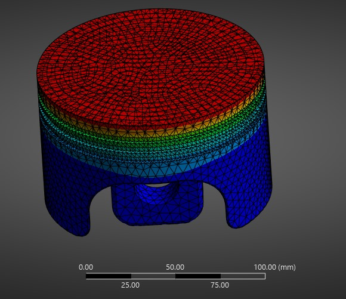 | 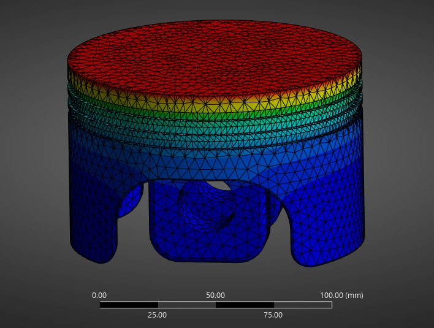 |
| *ANSYS Solid Tetrahedral Mesh on Piston Crown Geometry* | *Thermal Contour Overview across Piston Substrate* |

---

### 2. Transient Thermal Analysis (Temperature & Heat Flux)
| Metric | 0.2 mm TBC Coating | 2.0 mm TBC Coating / Full Layer |
| :--- | :---: | :---: |
| **Temperature Field** | 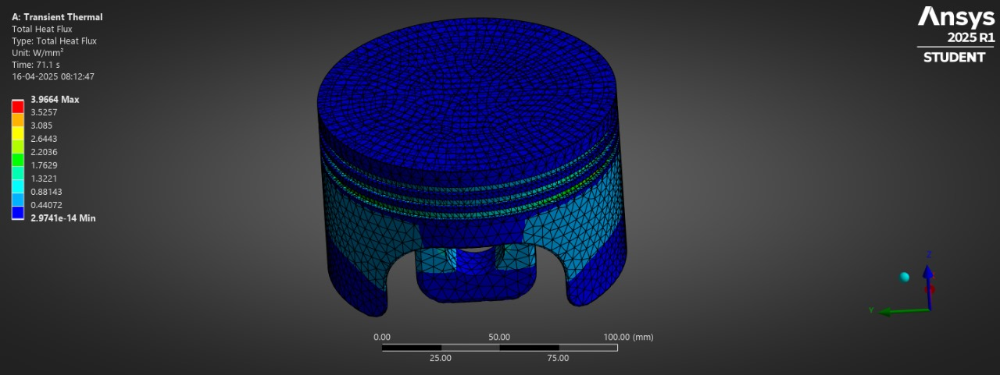 | 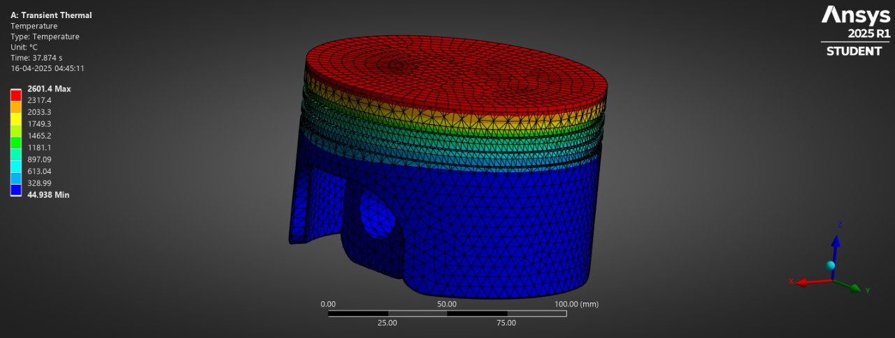 |
| **Peak Temperature** | **2314.3 °C** | **2601.4 °C** |
| **Heat Flux** | 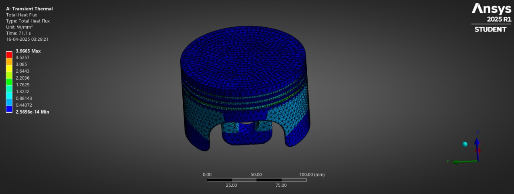 | 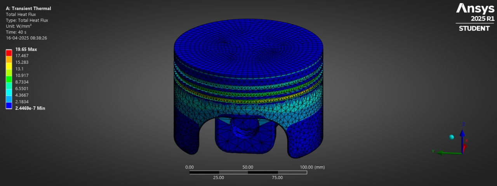 |
| **Max Heat Flux** | **3.97 W/mm²** | **19.65 W/mm²** |

---

### 3. Static Structural Analysis (Von-Mises Stress & Deformation)
| Structural Metric | 0.2 mm TBC Coating | 2.0 mm TBC Coating | Uncoated Baseline |
| :--- | :---: | :---: | :---: |
| **Von-Mises Stress** | 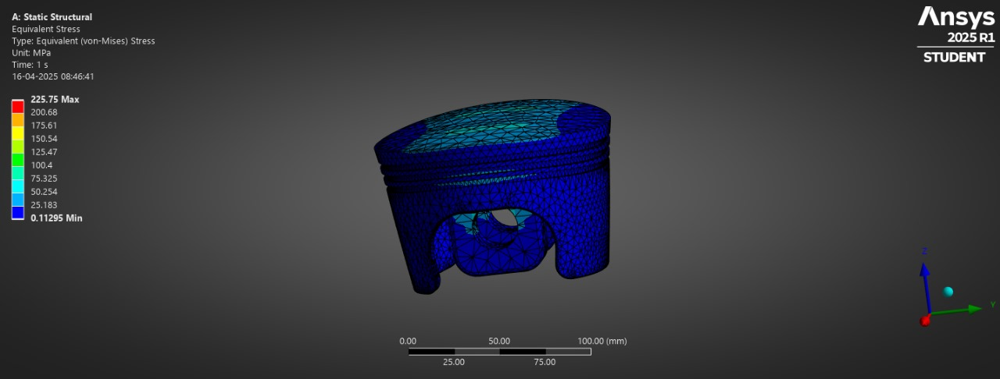 | 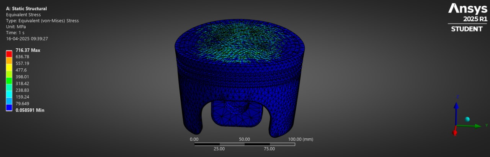 | — |
| **Max Stress** | **225.75 MPa** | ⚠️ **716.37 MPa** | ~186 MPa |
| **Total Deformation** | 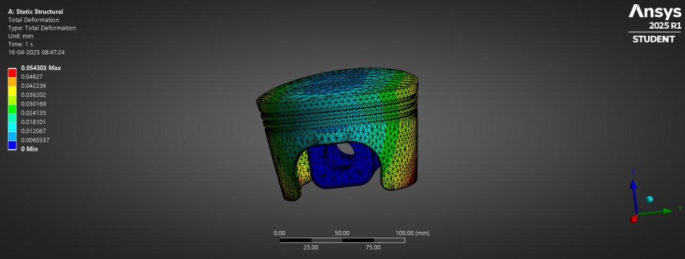 | 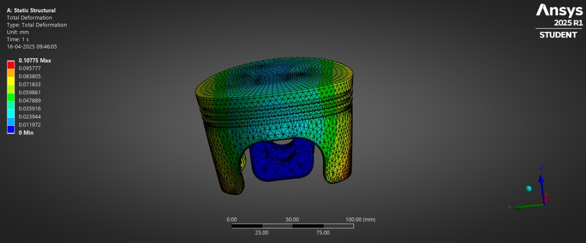 | 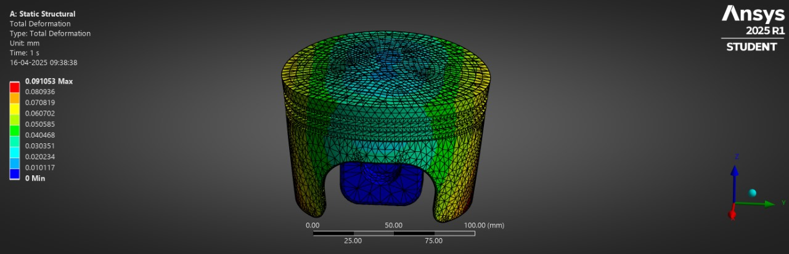 |
| **Max Deformation** | **0.0543 mm** (*-40.6%*) | **0.1078 mm** | **0.0910 mm** |

---

### 4. Strain, Directional Deformation & Fatigue Life Gallery
| Fatigue Life Contour (Min: 16,655 Cycles) | Elastic Strain (0.2 mm TBC) | Elastic Strain (2.0 mm TBC) |
| :---: | :---: | :---: |
| 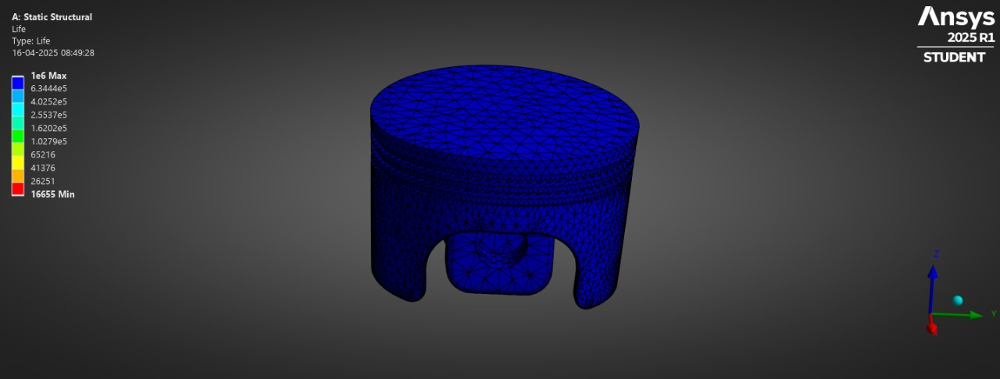 | 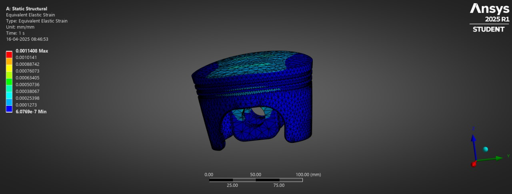 | 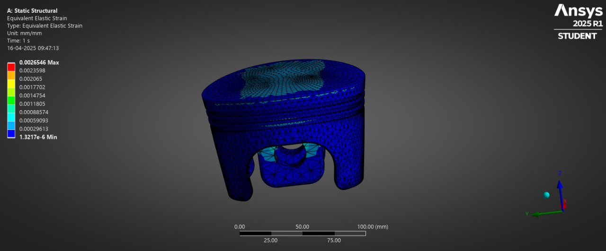 |

| Directional Deformation (0.2 mm TBC) | Directional Deformation (2.0 mm TBC) |
| :---: | :---: |
| 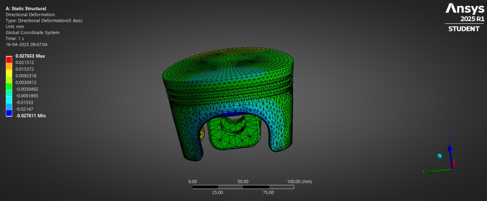 | 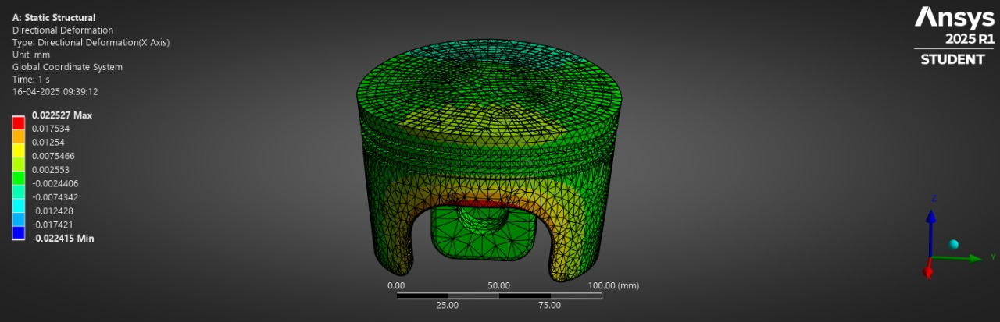 |

---

## ⚡ Mathematical & Thermodynamic Foundations

### 1. Slider-Crank Kinematics
Instantaneous cylinder volume $V(\theta)$ as a function of crank angle $\theta$:
$$V(\theta) = V_c \left[1 + \frac{CR-1}{2}\left(R + 1 - \cos(\theta) - \sqrt{R^2 - \sin^2(\theta)}\right)\right]$$
Where $V_c$ is clearance volume, $CR$ is compression ratio (10:1), and $R = l / r$ is connecting rod to crank radius ratio.

### 2. Wiebe Combustion Model
Mass fraction burned $x_b(\theta)$ during combustion (355° - 395° crank angle):
$$x_b(\theta) = 1 - \exp\left[-a \left(\frac{\theta - \theta_s}{\Delta \theta}\right)^m\right]$$
- $a = 5.0$ (Efficiency factor)
- $m = 3.0$ (Form factor for high-speed petrol engines)
- $\theta_s = 355^\circ$ (Start of ignition / BTDC)
- $\Delta\theta = 40^\circ$ (Combustion duration)

### 3. Heat Transfer & Polytropic Processes
- Compression stroke ($180^\circ \rightarrow 360^\circ$): Polytropic process $PV^n = \text{const}$ with $n \approx 1.35$.
- Heat Loss (Newton's Law adaptation):
  $$\dot{Q} = h_c(\theta) A(\theta) [T_{\text{gas}}(\theta) - T_{\text{wall}}]$$
- Variable specific heat ratio:
  $$\gamma(T) = 1.38 - 0.08 \left(\frac{T}{T_{\text{peak}}}\right)$$

### 4. Bayesian Optimization Objective Function
$$\text{Score} = \alpha (N_f) - \beta (\sigma_{\text{vonMises}}) + \gamma (\text{Heat Flux Reduction}) - \delta (\text{Cracking Probability})$$
Where:
- $N_f$: Thermal Fatigue Life (Cycles) [Maximizing]
- $\sigma_{\text{vonMises}}$: Equivalent Stress (MPa) [Minimizing]
- Objective weights: $\alpha = 0.4$, $\beta = 0.3$, $\gamma = 0.2$, $\delta = 0.1$.

---

## 📊 Key Engineering Conclusions & FEA Results

| Metric | Uncoated Piston | 0.2 mm TBC | 1.0 mm TBC (Optimal) | 2.0 mm TBC |
| :--- | :---: | :---: | :---: | :---: |
| **Peak Temperature (°C)** | ~2500 °C | 2314 °C | ~2400 °C | 2546 °C |
| **Heat Flux (W/mm²)** | ~4.0 W/mm² | 3.97 W/mm² | ~8.5 W/mm² | 19.65 W/mm² |
| **Von-Mises Stress (MPa)** | ~186 MPa | **225.75 MPa** | **370.00 MPa** | ⚠️ **716.37 MPa** |
| **Total Deformation (mm)** | 0.0910 mm | **0.0543 mm** (*Best*) | 0.0680 mm | 0.1078 mm |
| **Fatigue Life (Cycles)** | 16,655 | ~16,000 | **15,000** | Degraded |

> **Key Takeaway**: A **0.2 mm to 1.0 mm TBC coating** provides the ideal balance: reducing structural piston expansion by **40.6%** while keeping thermal stresses safely below critical material yield limits. Coating thicknesses above 1.5 mm generate severe thermal expansion mismatch ($CTE$), causing high residual stresses (716+ MPa) and high risk of coating delamination/cracking.

---

## 📁 Repository Code Structure

```
.
├── CAD files/                   # Parametric IGES files (0.2mm to 2.25mm coated & uncoated heads)
│   ├── 0.2mm_Coated.iges
│   ├── 1mm-Coated.iges
│   └── Uncoated-Head.iges
├── Images/                      # 23 FEA Visualization & Simulation Contours
├── ansys reports/               # ANSYS PDF Verification Reports
├── markdown/                    # Mathematical & Optimization documentation
│   ├── BO.md                    # Bayesian Optimization notes
│   └── weibei.md                # Wiebe combustion model notes
├── engine_simulation.py         # 4-Stroke Engine Thermodynamic Calculator
├── tbc_optimizer.py             # Gaussian Process Bayesian Optimizer Engine
├── tbc_optimizer_gui.py         # Tkinter Desktop GUI for TBC Optimization
├── temperature_plot_gui.py      # Tkinter Desktop GUI for Heat Flux & Temp Plots
├── transient.py                 # Transient Heat Conduction Solver
├── transient_gui.py             # Tkinter Desktop GUI for Transient Conduction
├── visualization.py             # Matplotlib Engine Plotting Engine
├── generate_data.py             # Cycle Excel Dataset Exporter (1° intervals)
├── generate_sampled_data.py     # Multi-RPM Excel Dataset Exporter (1000-5000 RPM)
├── index.html                   # Interactive Presentation & Web Dashboard
├── requirements.txt             # Python Package Dependencies
└── README.md                    # Project Documentation
```

---

## 🛠️ Installation & Setup

### Prerequisites
- **Python 3.8+**
- **pip**

### Dependencies Installation
```bash
pip install -r requirements.txt
```

*Required packages*: `numpy`, `scipy`, `matplotlib`, `pandas`, `scikit-learn`, `openpyxl`.

---

## 🚀 How to Run

### 1. Launch Desktop GUIs
- **TBC Bayesian Optimizer GUI**:
  ```bash
  python tbc_optimizer_gui.py
  ```
- **Temperature & Heat Flux Plotter GUI**:
  ```bash
  python temperature_plot_gui.py
  ```
- **Transient Heat Conduction GUI**:
  ```bash
  python transient_gui.py
  ```

### 2. Execute Simulations & Data Generators
- **Run Thermodynamic Engine Cycle Simulation & Save Plots**:
  ```bash
  python visualization.py
  ```
- **Generate Detailed Excel Cycle Datasets (720 points per cycle)**:
  ```bash
  python generate_data.py
  ```
- **Generate Multi-RPM Datasets (1000 - 5000 RPM)**:
  ```bash
  python generate_sampled_data.py
  ```

### 3. Open Interactive Web Dashboard / Presentation
Open `index.html` in any web browser to view the full interactive presentation with live Chart.js engine plots and MathJax equations.

---

## 📚 References & Literature
1. Heywood, J. B., *"Internal Combustion Engine Fundamentals"*, McGraw-Hill Education.
2. Ferguson, C. R., & Kirkpatrick, A. T., *"Internal Combustion Engines: Applied Thermosciences"*, Wiley.
3. Shah, R. A., et al., *"Thermal Barrier Coatings for Internal Combustion Engines"*, Journal of Thermal Spray Technology.
4. ANSYS Mechanical User Manual & Thermal-Structural Coupled FEA Documentation.

---

## 📄 License
This project is released under the **MIT License**.