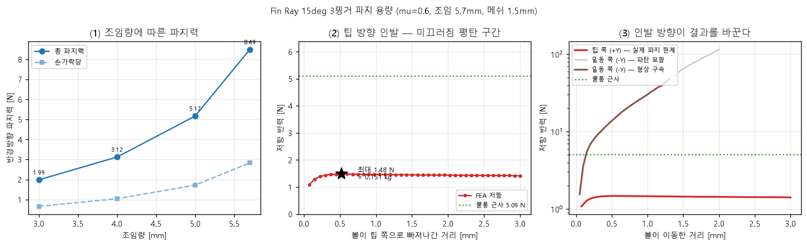

# Fin Ray 3핑거 그리퍼 — 파지 가능 무게 상한

15deg 형상, NinjaFlex TPU, μ=0.6 가정. 2026-07-30.

---

## 결론

**조임 5.7 mm, μ=0.6 조건에서 무게 상한은 0.151 kg (1.48 N) 이다.**

인발 시험에서 저항이 볼 이동 0.525 mm 에서 1.480 N 으로 정점을 찍고 그 뒤로
평탄해진다. 전형적인 미끄러짐 거동이며, 접촉압력이 전 구간 0.21 MPa 이하
(재료 전단계수 3.71 MPa 의 6%) 로 수치 파탄이 없다.

---

## 1. 조임량별 파지력

메쉬 1.5 mm, 절점 26,469 / 요소 95,307 (+접촉 20,337). 세 손가락 반력이
소수점 3자리까지 동일해 대칭성 검증을 통과했다.

| 조임 [mm] | 손가락당 [N] | 총 파지력 [N] | 쿨롱 근사 상한 [kg] |
|---|---|---|---|
| 3.0 | 0.662 | 1.986 | 0.12 |
| 4.0 | 1.040 | 3.120 | 0.19 |
| 5.0 | 1.722 | 5.167 | 0.32 |
| **5.7** | **2.830** | **8.490** | 0.52 |

5.7 mm 가 상한이다. 6.9 mm 에서는 메쉬 3종(2.5mm 1차, 1.5mm 1차, 2.5mm 2차)이
모두 수치 파탄한다 — 힘이 급등하면서 접촉면적은 오히려 줄어드는, 물리적으로
불가능한 조합이 나타난다.

---

## 2. 쿨롱 근사는 3.4배 과대평가한다

| | 값 | 무게 환산 |
|---|---|---|
| 쿨롱 근사 (μ × 총 파지력) | 5.094 N | 0.519 kg |
| **FEA 실측** | **1.480 N** | **0.151 kg** |
| 비 | 0.29 | |

**원인: 접촉 방향.** 접촉 구역이 y = 6~31 mm 인데 볼 적도가 y = 30 이다. 즉
세 손가락이 볼을 **아래에서 받치는** 배치라, 접촉면 법선이 반경방향이 아니라
상당한 축방향 성분을 갖는다. 반경방향 파지력 8.49 N 이 그대로 마찰에 동원되지
않는다.

게다가 볼이 팁 쪽으로 빠져나가면서 손가락이 풀려 닫힌 접촉요소가 147 → 81 개로
줄어든다. 파지력 자체가 감소하는 것이다.

→ **μ × N 공식은 이 형상에서 쓸 수 없다.**

---

## 3. 인발 방향을 반드시 구분해야 한다

같은 모델에서 볼을 빼내는 방향만 바꾸면 답이 30배 달라진다.

| 방향 | 자세 | 최대 저항 | 거동 |
|---|---|---|---|
| **+Y (팁 쪽)** | 뒤집은 픽업 — 실제 그리퍼 | **1.48 N** | 미끄러짐, 평탄 |
| −Y (밑동 쪽) | 손가락 위 자세 | 47.5 N+ | 형상 구속, 평탄 없음 |

손가락이 볼을 아래에서 받치므로, −Y 로 당기는 것은 볼을 바구니 안으로 더
밀어넣는 것과 같다. 저항이 한없이 커지고 (1.35 mm 에서 수치 파탄) 마찰 한계가
드러나지 않는다.

**실제로 물건을 드는 자세는 뒤집은 자세**이고, 그때 중력은 볼을 팁 쪽으로
당긴다. 따라서 +Y 방향이 파지 한계를 준다.

---

## 4. 기존 보고서(2026-07-27~28)와의 차이

| | 기존 | 재구축 |
|---|---|---|
| 형상 | 25deg | 15deg |
| 조임 | 8.0 mm | 5.7 mm |
| 총 파지력 | 16.65 N | 8.49 N |
| 무게 상한 | 1.02 kg | **0.151 kg** |

기존 값이 높게 나온 이유 세 가지. 형상이 달라 직접 비교는 부적절하지만,
세 요인 모두 상한치를 부풀리는 방향이다.

1. **조임 8 mm 는 파탄 구간이다.** 재구축 검증에서 6.9 mm 부터 메쉬와 무관하게
   수치 파탄이 일어난다.
2. **메쉬가 접촉힘을 40~48% 과대평가한다.** 기존이 쓴 2.5 mm 메쉬는 접촉 패치를
   요소 5~7개로만 표현한다. 1.0 mm 로 줄이면 접촉힘이 그만큼 내려간다
   (1.5 mm 와 1.0 mm 는 10% 차이로 수렴).
3. **상한치가 FEA 가 아니라 손계산이다.** 기존 4.3절의 1.02 kg 은
   0.6 × 16.65 = 9.99 N 이라는 쿨롱 공식이며, 위 2절대로 이 공식이 3.4배
   과대평가한다.

기존 보고서의 들어올리기 해석(4.4절)에는 볼 무게가 하중으로 걸려 있지 않다.
"들어올리는 동안 응력이 소수점 15자리까지 불변", "볼 이동 10.000/15.000 mm" 가
근거다 — 마찰로 자기 무게를 버텼다면 접촉 접선응력이 바뀌어 응력이 불변일 수 없다.

---

## 5. 가정과 한계

| 항목 | 내용 | 영향 |
|---|---|---|
| **마찰계수** | μ=0.6 은 실측 없는 가정 | 상한치가 **선형 비례**. μ=0.3 이면 0.076 kg, μ=0.9 면 0.227 kg |
| 메쉬 | 1.5 mm (Student 요소 한도로 3핑거는 이것이 최선) | 1.0 mm 대비 **±10%** |
| 조임 한계 | 5.7 mm 초과는 수치 파탄 | 더 세게 쥐면 상한이 올라가나 확인 불가 |
| 자기접촉 | 리브끼리 닿는 것을 모델에 넣지 않음 | 6.9 mm 파탄의 유력한 원인 |
| 볼 형상 | 접촉 해석은 R=40 해석적 구면 (접촉부가 정확히 구면이라 오차 없음). 질량은 잘린 실제 체적 245,042 mm³ | 완전구로 계산하면 무게 8.6% 과대 |
| 동적 효과 | 정적 해석 | 빠르게 들어올리면 관성력만큼 더 필요 |

**μ 가 지배적 불확실성이다.** 실측하면 결과 전체가 그 비율로 스케일된다.

---

## 6. 검증 근거

| 항목 | 결과 |
|---|---|
| 요소 부피 합 vs CAD 체적 | 15,363.7 / 15,363.7 mm³ (오차 0.00%) |
| 단일핑거 PDF 재현 (o1@2.5mm) | 3.3 mm 까지 7% 이내 일치 |
| 3핑거 대칭성 | 손가락 간 편차 0.00% |
| 접촉 관통량 | 전 구간 0.015 mm 이하 |
| 인발 곡선 접촉압력 | 최대 0.213 MPa (전단계수의 6%) |

---

## 7. 다음에 할 것

| 항목 | 이유 |
|---|---|
| **μ 실측** | 유일한 지배적 가정. 이것 없이는 상한치가 ±3배 밴드다 |
| 자기접촉 추가 | 6.9 mm 이상 조임 가능 여부 판정 |
| 25deg 로 동일 시험 | 기존 보고서와 직접 비교 가능해짐 |
| 손가락 배치 높이 조정 | 현재는 볼을 아래에서 받치는 형태. 적도 위에서 감싸면 상한이 크게 오를 것 |
