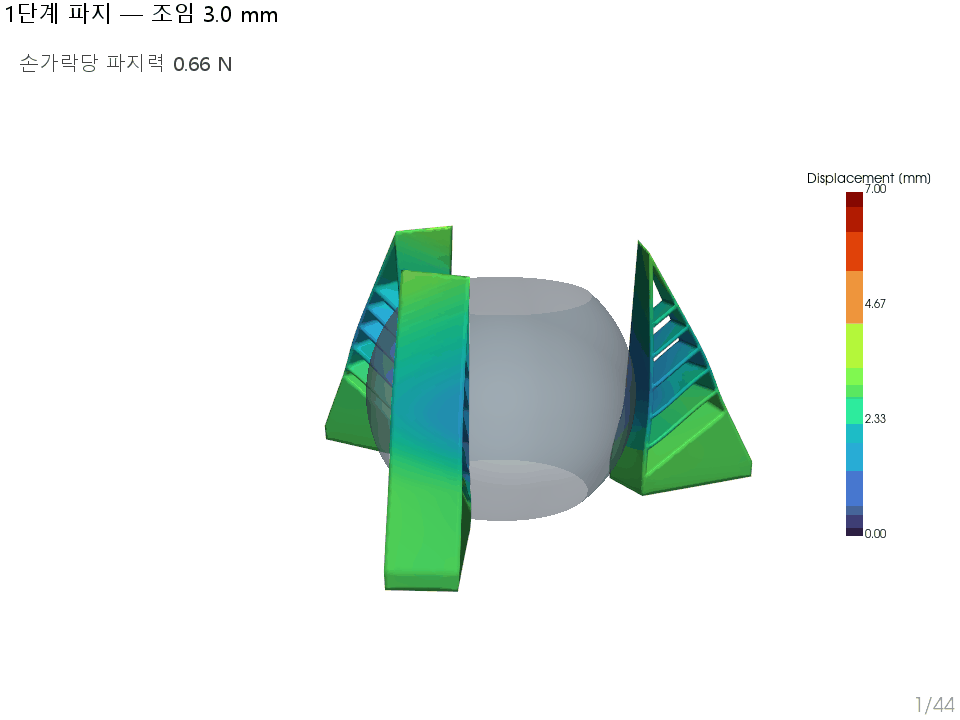

# Fin Ray 3핑거 그리퍼 — 파지 가능 무게 상한 FEA

Fin Ray 형상 소프트 그리퍼(NinjaFlex TPU)가 구를 얼마나 무겁게까지 잡을 수 있는지
유한요소해석으로 구한다. Ansys MAPDL 2026 R1 + PyMAPDL.

**실측 기준값: 약 1 kg** (그리퍼가 아예 놓치는 지점)

---

## 현재 결론

실측을 기준으로 대조한 결과 **이 그리퍼는 마찰이 아니라 형상 구속(form closure)으로
볼을 잡는다.** 접촉이 볼 적도 아래(y = 6~31 mm, 적도 y = 30)에 몰려 있어 세 손가락이
볼을 아래에서 받치는 배치이기 때문이다.

| 항목 | 값 |
|---|---|
| 실측 파지 상한 | 약 1 kg |
| 1 kg 에서 모델의 볼 처짐 | 0.32 mm — 안정 유지 |
| 모델이 놓치지 않고 버틴 최대 | 3.2 kg 이상 (신뢰 구간 끝) |
| 쿨롱 근사 μ x N (참고) | 0.52 kg — 이 형상에서는 성립하지 않음 |

**미해결**: 모델이 실측 1 kg 을 설명하지만 '놓치는 순간'은 재현하지 못한다.
밑동을 변위로 고정하면 볼이 손가락을 벌릴 수 없어 형상 구속이 절대적이 되는 것으로
보이며, 힘 구동(`--grip-force`)으로 검증 중이다.

자세한 내용: [보고서 PDF](07_docs/report/FinRay_3핑거_파지_무게_상한.pdf)



---

## 알아낸 것

**1. 인발 방향이 답을 30배 가른다.**
접촉이 적도 아래이므로 +Y(팁 쪽)로 빼내면 순수 마찰(0.151 kg), 실제 중력 방향인
−Y 로는 형상 구속이 지배한다(3.2 kg 이상). 초판 보고서는 방향을 잘못 잡아 결론이
틀렸다.

**2. 쿨롱 공식 μ×N 은 이 형상에 쓸 수 없다.**
접촉 법선이 반경방향이 아니라 큰 축방향 성분을 가져, 반경 파지력 8.49 N 이 그대로
마찰에 동원되지 않는다.

**3. 기존 2.5 mm 메쉬는 접촉힘을 40~48% 과대평가한다.**
접촉 패치를 요소 5~7개로만 표현하기 때문이다(1.0 mm 에서는 24~61개). 구조 강성은
이미 수렴해 있으므로 구조가 아니라 접촉 쪽 문제다.

**4. 조임 6.9 mm 는 메쉬와 무관하게 수치 파탄한다.**
힘이 급등하면서 접촉면적은 오히려 줄어드는 불가능한 조합이 나타난다. 리브 간
자기접촉 미반영이 유력하나 확인하지 못했다.

---

## 폴더 구조

```
01_geometry/   STEP 원본 (핀레이 + 볼이 한 파일에 들어 있다)
02_mesh/       메쉬 및 메타데이터
04_scripts/    mesh → journal(해석) → post(후처리) 순
05_results/    raw(CSV) / processed(변위 캐시)
06_image/      plot(그래프) / figures(3D 렌더, GIF)
07_docs/       report(보고서) / log(재구축 기록)
```

솔버 작업 폴더는 **프로젝트 밖**(`C:\ANSYS_work`)에 둔다. OneDrive 동기화 충돌과
비ASCII 경로 문제를 피하기 위해서다. `04_scripts/config.py` 가 이 규칙을 강제한다.

---

## 시작하기

```powershell
python -m venv C:\ANSYS_work\venv
C:\ANSYS_work\venv\Scripts\python.exe -m pip install -r 04_scripts\requirements.txt
C:\ANSYS_work\venv\Scripts\python.exe 04_scripts\config.py   # 경로 자동 탐지 확인
```

- 실행 순서: [07_docs/실행방법.md](07_docs/실행방법.md)
- 다른 PC 로 옮기기: [07_docs/다른_PC로_옮기기.md](07_docs/다른_PC로_옮기기.md)
- 재구축 경위와 막혔던 지점: [07_docs/log/00_재구축_기록.md](07_docs/log/00_재구축_기록.md)

MAPDL 경로·작업 폴더·한글 폰트는 자동 탐지된다. 실패하면 환경변수
`FINRAY_ANSYS_EXE` / `FINRAY_WORK` / `FINRAY_KR_FONT` 로 지정한다.

---

## 환경

| 항목 | 값 |
|---|---|
| 솔버 | Ansys Student v261 (2026 R1) — 절점/요소 **128,000 한도**, 동시 세션 1개 |
| 모델 규모 | 절점 26,469 / 솔리드 95,307 / 접촉 20,337 (한도의 90%) |
| 재료 | NinjaFlex TPU — Mooney-Rivlin c10=0.385, c01=1.47 MPa |
| 요소 | SOLID285 (mixed u-P) + TARGE170/CONTA174 |

`ansys-mapdl-reader` 는 **쓰지 말 것.** 2026 R1 결과 파일을 잘못 읽어 변위가
1e307 급 쓰레기값으로 나온다. 결과 추출은 `mapdl.post_processing` 을 쓴다.

마찰 접촉에는 `NROPT,UNSYM` 이 **필수**다. 대칭 솔버로는 미끄러짐 구간에서
서브스텝 하나를 두 시간 동안 넘기지 못한다.
