# Pipe–Flange Static Structural FEA

<p align="center">
  <b>ANSYS Mechanical | Finite Element Analysis | Shared Topology vs Bonded Contact</b>
</p>

A static structural finite element study of a steel pipe–flange assembly, focused on how two interface-modelling approaches affect deformation, equivalent stress, and reaction force.

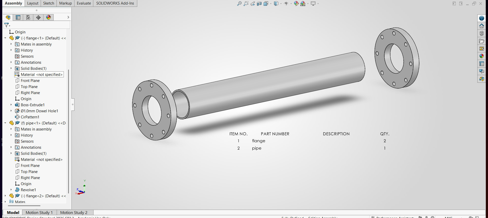

## 📌 Project Overview

This project compares two ANSYS Mechanical representations of the pipe–flange interface:

- **Shared Topology**
- **Bonded Contact**

The comparison uses the same overall geometry, Structural Steel material, 500 N bearing load, fixed flange bolt-hole faces, and prescribed body mesh sizing.

**Workflow**

`SOLIDWORKS → ANSYS Discovery → ANSYS Workbench / Mechanical → Post-processing`

## 🔧 Analysis Setup

| Parameter | Value |
|---|---|
| Analysis | Static Structural |
| Software | ANSYS Mechanical Enterprise 2026 R1 (Student) |
| CAD | SOLIDWORKS Design Standard 2026 SP3.2 |
| Geometry preparation | ANSYS Discovery Release 2026 R1 |
| Material | Structural Steel |
| Bearing load | 500 N, Global X = −500 N |
| Support | Fixed support on 16 cylindrical flange bolt-hole faces |
| Pipe mesh sizing | 1.5 mm |
| Flange mesh sizing | 3.0 mm |

### Geometry

| Component | Dimension |
|---|---:|
| Pipe outer diameter | 29.80 mm |
| Pipe inner diameter | 27.00 mm |
| Pipe length | 225.11 mm |
| Pipe wall thickness | 1.40 mm |
| Flange outer diameter | 60.00 mm |
| Flange bore | 30.00 mm |
| Flange thickness | 7.53 mm |
| Bolt holes | 8 × Ø4.00 mm per flange |
| Radial clearance | 0.10 mm |

## 📊 Results Comparison

| Result | Shared Topology | Bonded Contact |
|---|---:|---:|
| Maximum total deformation | **0.01212 mm** | **0.011157 mm** |
| Maximum equivalent (von-Mises) stress | **20.357 MPa** | **19.548 MPa** |
| Total reaction | **500.46 N** | **500 N** |

The two models show the same broad structural response: deformation is concentrated in the pipe region, while the flange-hole regions are restrained. The numerical differences are associated with the interface representation and independently generated meshes.

### Deformation

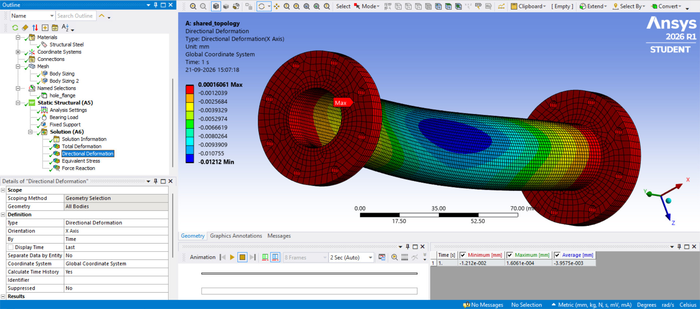

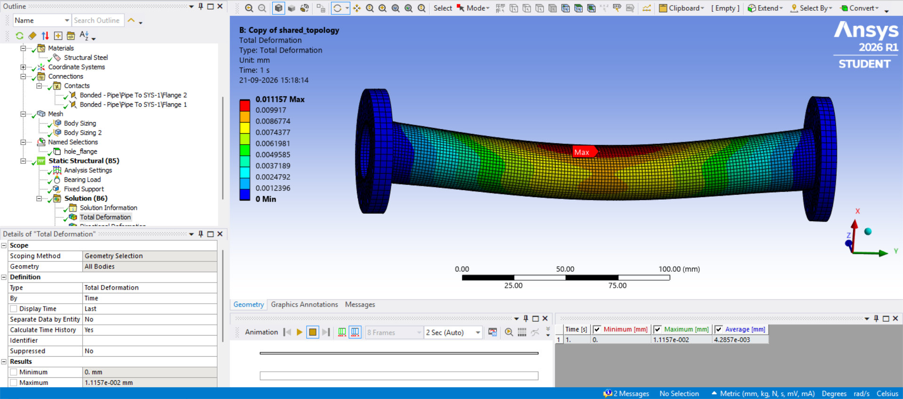

### Equivalent Stress

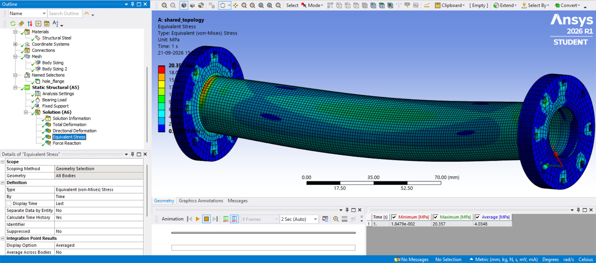

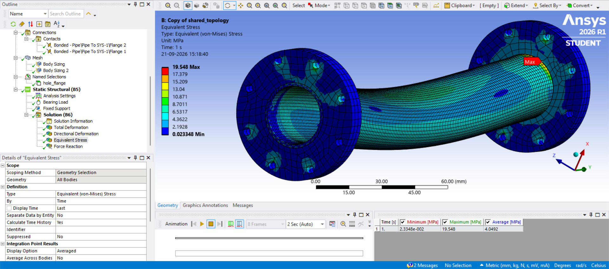

### Reaction Force

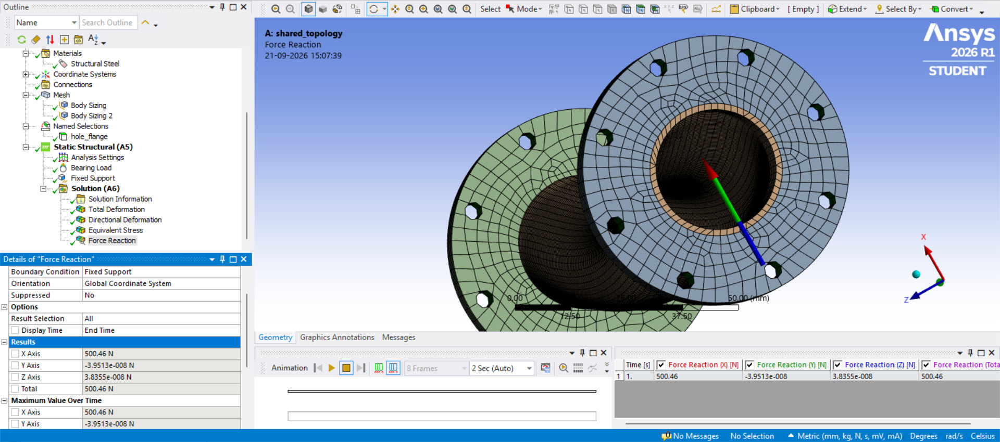

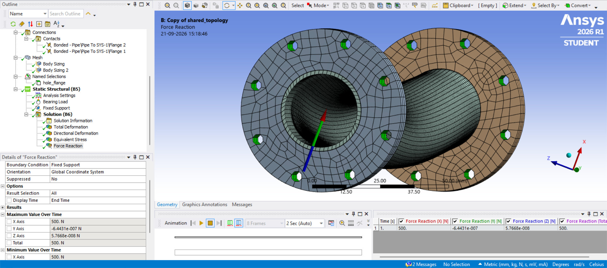

## 🧩 Interface Modelling

### Shared Topology

The shared-topology model was prepared so the connected geometry could be represented without explicit contact definitions at the pipe–flange interfaces.

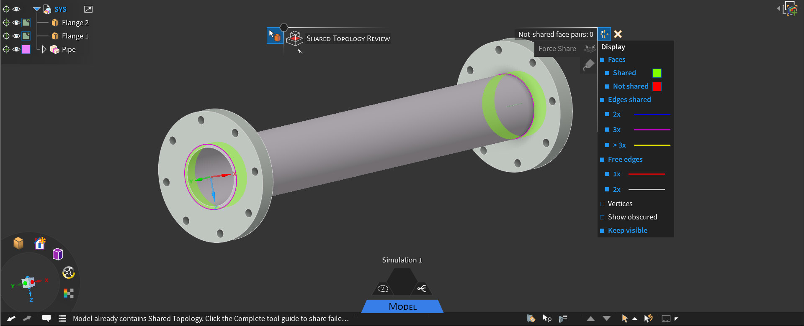

### Bonded Contact

The contact model represents the pipe–flange interfaces using bonded contact definitions.

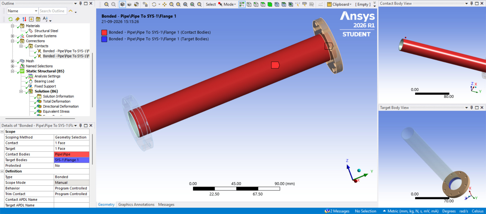

## 🕸️ Meshing

Body sizing was applied using:

- **1.5 mm** for the pipe
- **3.0 mm** for the flange bodies

The supplied analysis also contains mesh-quality checks including element quality, skewness, and orthogonal quality.

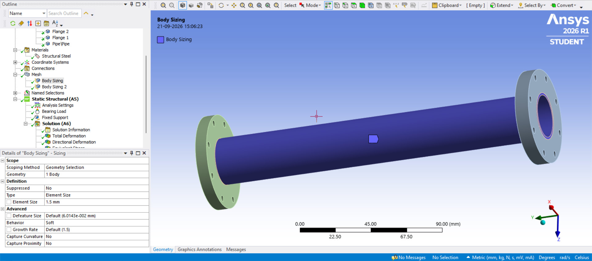

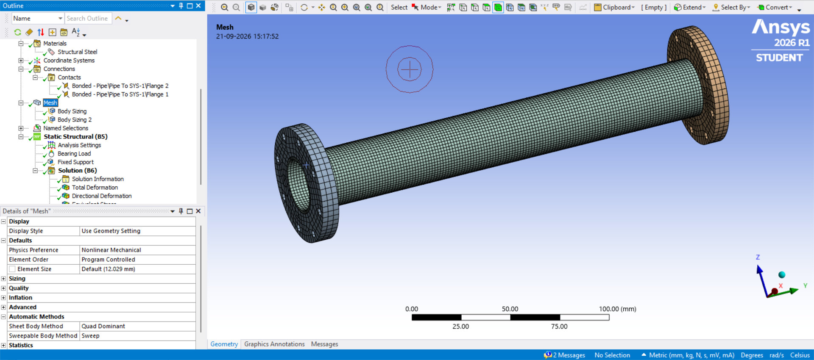

## 📁 Repository Structure

```text
pipe-flange-fea/
├── README.md
├── SCREENSHOT_INDEX.md
├── CAD/
│   └── SOLIDWORKS/
│       ├── Pipe.SLDPRT
│       ├── Flange.SLDPRT
│       ├── Pipe-Flange-Assembly.SLDASM
│       ├── Pipe.SLDDRW
│       └── Flange.SLDDRW
├── ANSYS/
│   ├── Workbench/
│   ├── Archive/
│   ├── Shared-Topology/
│   └── Contact/
├── Images/
│   ├── CAD/
│   ├── Setup/
│   ├── Mesh/
│   └── Results/
├── Results/
└── report/
    └── Pipe-Flange-FEA-Report.pdf
```

## 📄 Detailed Report

The full report contains the modelling procedure, CAD geometry, boundary conditions, mesh setup, result screenshots, quantitative comparison, engineering interpretation, and limitations.

➡️ **[Open the detailed FEA report](report/Pipe-Flange-FEA-Report.pdf)**

## ⚠️ Modelling Limitations

This study should be interpreted as a model comparison for the specified setup. The supplied analysis does not include:

- Explicit bolt geometry or bolt preload
- A formal mesh-convergence study
- Experimental validation
- A detailed record of all contact-formulation settings
- A full representation of real bearing/contact behaviour

Peak stress values can also be sensitive to local geometry, mesh density, and interface modelling.

## 🎯 Skills Demonstrated

**CAD / Design**
- SOLIDWORKS
- Part modelling
- Assembly modelling
- Engineering drawings

**CAE / FEA**
- ANSYS Mechanical
- ANSYS Discovery
- Static Structural analysis
- Shared Topology
- Bonded Contact
- Mesh sizing and quality assessment
- Boundary conditions and loading
- Equivalent (von-Mises) stress
- Total and directional deformation
- Reaction-force verification

## 👨‍🔧 Project Focus

This project demonstrates a workflow from CAD preparation through finite element setup, interface modelling, meshing, post-processing, and quantitative comparison of two connection representations.

**Date of analysis:** 21 September 2026
