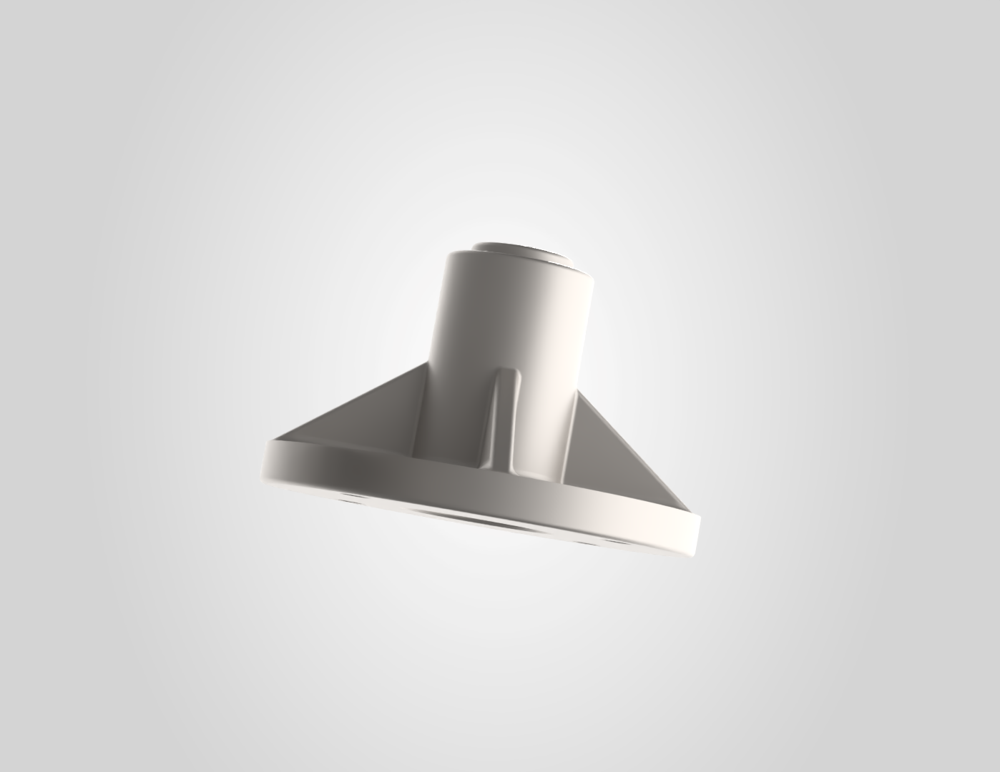
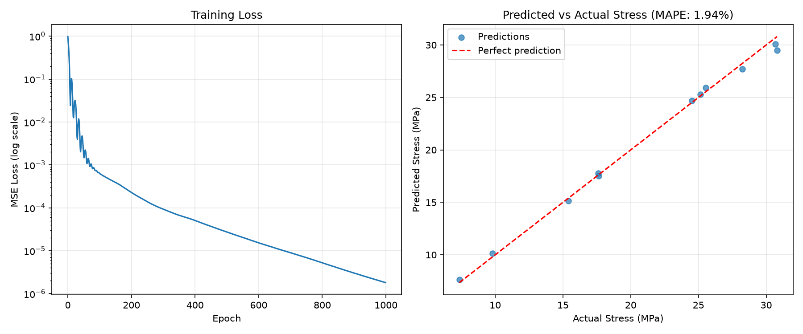
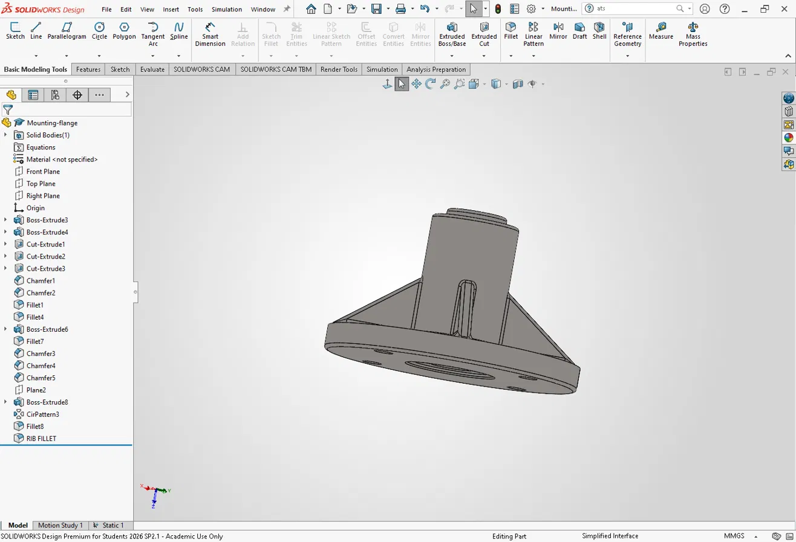
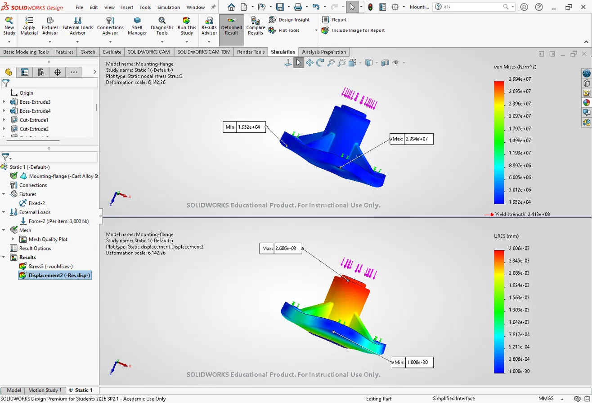

# ML Surrogate Model for Structural FEA

A neural network surrogate model that predicts peak von Mises stress in a parametric mounting flange, trained on 55 SolidWorks finite element simulations. Achieves **1.94% mean absolute percentage error** against FEA ground truth.



---

## Overview

Finite element analysis is accurate but computationally expensive. Each simulation of this mounting flange takes several minutes to mesh and solve — prohibitive when exploring hundreds of design variations during early-stage optimization.

This project builds a **surrogate model**: a neural network trained on a modest set of FEA results that learns the underlying stress response and predicts new cases in milliseconds. The workflow spans the full engineering pipeline, from CAD design through simulation to machine learning.

**Pipeline:** Technical drafting → 3D modeling → FEA simulation → dataset generation → neural network training → validation

---

## Results

| Metric | Value |
|---|---|
| Mean Absolute Percentage Error | **1.94%** |
| Mean Absolute Error | 0.39 MPa |
| Maximum Error | 1.32 MPa |
| Training samples | 44 |
| Test samples | 11 |



*Left: training loss over 1000 epochs (log scale). Right: predicted vs. actual peak stress on the held-out test set, with the diagonal representing perfect prediction.*

---

## Component Design

The test component is a **mounting flange** — a circular base plate with a central hub, four radial stiffening ribs, four bolt holes, and a raised locating boss. The geometry was selected because it produces a non-trivial stress distribution with clear concentration points at the rib-to-flange junctions.

### Specifications

| Feature | Dimension |
|---|---|
| Flange outer diameter | Ø160 mm |
| Flange thickness | 15 mm |
| Hub outer diameter | Ø55 mm |
| Hub height | 80 mm |
| Central through hole | Ø26 mm |
| Bolt holes | 4 × Ø10 mm on Ø130 mm bolt circle |
| Rib thickness | 8 mm |
| Material | Cast Alloy Steel (σ_yield = 241.3 MPa) |

### Technical Drawing

A full orthographic drawing set was produced in AutoCAD prior to 3D modeling, including top view, front view, and section view A-A with proper layer management, dimensioning, and title block.

📄 [`mounting-flange-drawing.pdf`](mounting-flange-drawing.pdf)

### 3D Model



The part was modeled parametrically in SolidWorks using revolved and extruded features, extruded cuts for the through hole and bolt pattern, circular patterns for the ribs and bolt holes, and fillets and chamfers at all stress-critical transitions. Parametric construction allowed the fillet radius to be varied programmatically across the simulation set without remodeling.

---

## FEA Simulation Campaign

### Study Setup

| Parameter | Configuration |
|---|---|
| Analysis type | Linear static |
| Material | Cast Alloy Steel |
| Fixtures | Fixed geometry on all four bolt hole cylindrical faces |
| Load | Distributed normal force on hub top face |
| Mesh | Standard tetrahedral, curvature-based refinement |



*von Mises stress (top) and resultant displacement (bottom) at 3000 N applied load. Stress concentrates at the rib-to-flange junctions; displacement is maximum at the hub top and zero at the fixed bolt holes — both consistent with expected physical behavior.*

### Parameter Space

Two design variables were swept across a full factorial grid:

- **Applied load:** 500 N → 3000 N (11 levels)
- **Rib base fillet radius:** 1 mm → 5 mm (5 levels)

This produced **55 simulations** covering the complete design space. All other parameters — fixtures, load face, material, and mesh settings — were held constant to isolate the effect of the two variables.

📊 [`fea-results.csv`](fea-results.csv)

---

## Surrogate Model

### Architecture

```
Input (2) → Linear(2, 32) → ReLU → Linear(32, 32) → ReLU → Linear(32, 1) → Output
```

A three-layer fully connected network mapping `[load_N, fillet_radius_mm]` to predicted peak von Mises stress.

| Hyperparameter | Value |
|---|---|
| Loss function | Mean Squared Error |
| Optimizer | Adam |
| Learning rate | 0.01 |
| Epochs | 1000 |
| Train/test split | 80 / 20 |

### Data Preprocessing

Both input features and the target variable were standardized to zero mean and unit variance before training. This is necessary because the raw inputs differ by three orders of magnitude (loads in the hundreds to thousands, fillet radii in single digits), which would otherwise cause the network to weight the load feature disproportionately during gradient descent.

### Training

Loss converged smoothly from 6.5 × 10⁻⁴ to 2 × 10⁻⁶ over 1000 epochs, with early oscillation during the initial optimizer warm-up phase and stable monotonic descent thereafter.

📓 [`surrogate-model.ipynb`](surrogate-model.ipynb)

---

## Discussion

**What worked.** The surrogate reproduces FEA peak stress within 2% across the full test set, and inference is effectively instantaneous compared to the minutes required per FEA solve. For a design-space exploration task, this represents a meaningful speedup.

**Limitations.** The load–stress relationship in linear static analysis is itself linear, which makes this a comparatively easy function to approximate — the network is not being stressed by the problem's complexity. The fillet radius effect is subtle (roughly 5% variation in peak stress across the 1–5 mm range) and contributes far less signal than the load term. A more demanding test would involve non-linear material behavior, contact, or a wider geometric parameter space.

**Next steps.**
- Expand the parameter space to include hub diameter, flange thickness, and rib count
- Introduce non-linear material models where the linear assumption breaks down
- Extend to a physics-informed neural network (PINN) incorporating the governing elasticity PDEs as loss terms, enabling comparable accuracy from a smaller training set

---

## Repository Contents

| File | Description |
|---|---|
| `surrogate-model.ipynb` | Full training pipeline — data loading, preprocessing, model definition, training, evaluation |
| `fea-results.csv` | Complete dataset: 55 simulations with inputs, stress, displacement, and safety factor |
| `mounting-flange-drawing.pdf` | AutoCAD orthographic drawing set with section view and title block |
| `flange-render.png` | SolidWorks Visualize render of the final part |
| `flange-feature-tree.png` | SolidWorks model with feature history |
| `fea-stress-plot.png` | von Mises stress and displacement contour plots |
| `results.png` | Training loss curve and predicted vs. actual scatter |

---

## Stack

**CAD & Simulation** — AutoCAD, SolidWorks, SolidWorks Simulation, SolidWorks Visualize
**Machine Learning** — Python, PyTorch, scikit-learn, pandas, NumPy, Matplotlib
