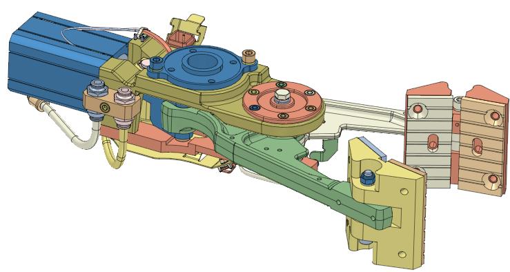
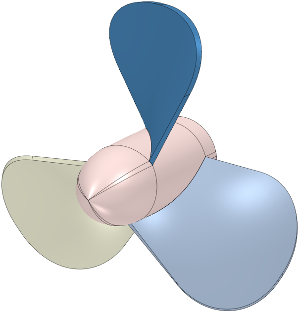
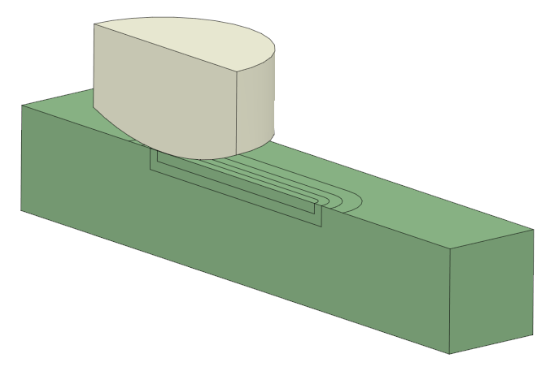
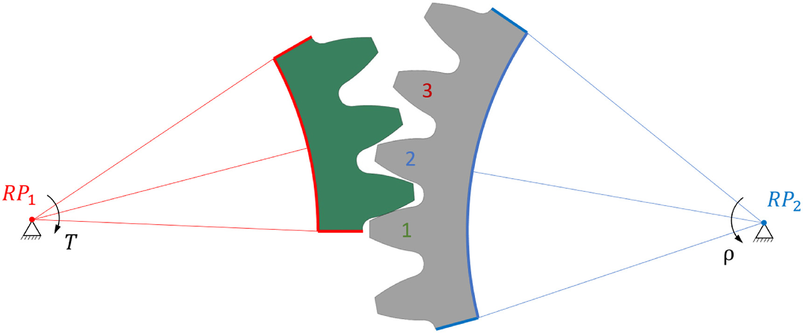
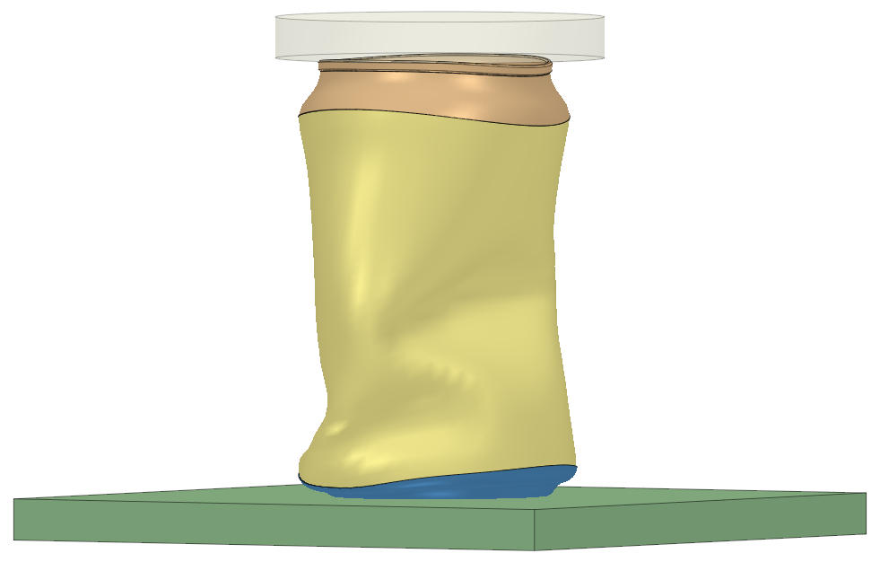

# PrePoMax Models

This repository will be used to share some larger PrePoMax models as .pmx files.

## Pneumatic Gripper

The Pneumatic Gripper model is prepared in PrePoMax v2.2.0. The CAD geometry was downloaded from the GrabCAD page: https://grabcad.com/library/pneumatic-gripper-11

The aim was to create a working mechanism example without concern to the stress fields, so a couple of rigid body constraints were used to speed up the analysis.

Download page: https://gitlab.com/MatejB/PrePoMax-Models/tree/main/Pneumatic_Gripper

## Fan

The fan model was prepared in PrePoMax v2.2.4 dev.

The aim was to create a hexahedral mesh for the fan axis and fan blade. For this reason only one third of the geometry was modeled and then copied and rotated to create the mesh of the entire model.

Download page: https://gitlab.com/MatejB/PrePoMax-Models/tree/main/Fan

## Pin on a Plate

The pin on a plate model was prepared in PrePoMax v2.2.0.

The aim was to create a wear simulation test model containing the new Boundarty Displacemenmt Step introduced in the previous versions of PrePoMax.

Download page: https://gitlab.com/MatejB/PrePoMax-Models/tree/main/Pin_on_a_Plate

## 3-Tooth Gear Wear

The 3-tooth gear wear model was prepared in PrePoMax v2.3.0.

The aim was to create a wear simulation of a plastic POM gear meshing with a steel gear. The model was prepared by Aljaž Ignatijev. The results were validated using experiemntal data and are described in a scientific open-access paper: **A computational model for analysing the wear behaviour of polymer gear** https://doi.org/10.1016/j.wear.2025.206066

Download page: https://gitlab.com/MatejB/PrePoMax-Models/tree/main/3_Tooth_Gear_Wear

## Soda can buckling - by Edilson Rosa

The soda can buckling model was prepared in PrePoMax v2.3.0. The author of the model is Edilson Rosa https://www.linkedin.com/feed/update/urn:li:activity:7328254529173385216/

The aim was to create a simulation of non-linear compression deformation of a soda can.

Download page: https://gitlab.com/MatejB/PrePoMax-Models/tree/main/Soda_Can_Buckling

